# System Architecture Specification: Groww AI-Powered Discovery Engine

> **Document Type:** Technical & System Architecture Specification  
> **Product Context:** Groww · Growth Engineering  
> **Related Documents:** [context.md](file:///d:/SAURABH/Groww%20Discovery%20Engine/context.md) | [Problem Sataement.txt](file:///d:/SAURABH/Groww%20Discovery%20Engine/Problem%20Sataement.txt)  
> **Target Strategic Metric:** 12-Month First-Time Mutual Fund SIP Continuation Rate  

---

## 1. Architectural Philosophy & Design Principles

The Groww AI Discovery Engine is designed not as an autonomous decision-maker or speculative text generator, but as an **auditable, evidence-first research operating system**. Every technical decision is anchored by five fundamental architectural principles:

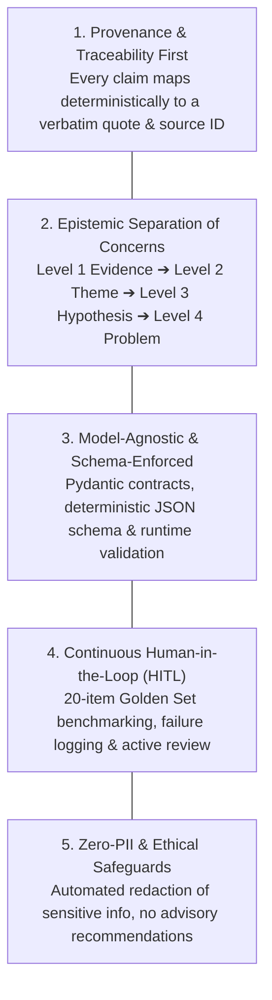

1. **Deterministic Traceability:** Any insight presented on an executive dashboard or research summary must be traceable down to the raw public post, timestamp, and verbatim quote substring. Hallucinated quotes break the entire pipeline.
2. **Epistemic Layering:** The architecture strictly isolates *what was said* (evidence) from *how it clusters* (themes), *how it might be explained* (hypotheses), and *what is confirmed by 1:1 user research* (validated problems).
3. **Strict Schema Contracts:** LLMs are never prompted for free-form summaries. All extractions must conform to an immutable 21-field data contract validated via JSON Schema / Pydantic.
4. **Active Quality Auditing:** A built-in evaluation subsystem continuously benchmarks model output against a human-labelled golden dataset across 7 dimensions of agreement.
5. **Zero-PII & Ethical Compliance:** Ingestion pipelines automatically scrub personally identifiable information (PII) including phone numbers, email addresses, PAN cards, and bank account details.

---

## 2. End-to-End System Architecture

The Problem Statement defines exactly **7 pipeline stages** (Collect → Clean → Extract → Discover Patterns → Generate Hypotheses → Compare Opportunities → Evaluate Quality). The diagram below maps these 7 stages plus a **presentation layer** (the PM Research Dashboard) which is not a pipeline stage but the interface through which findings are inspected and reviewed:

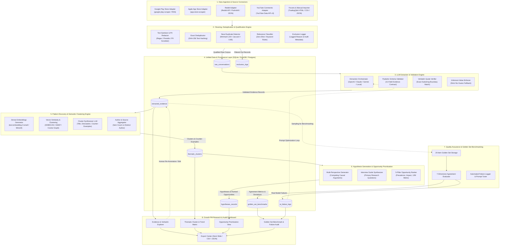

---

## 3. Detailed Component Architecture

### 3.1 Data Ingestion Subsystem

The Ingestion Subsystem abstracts source variations into a uniform raw schema.

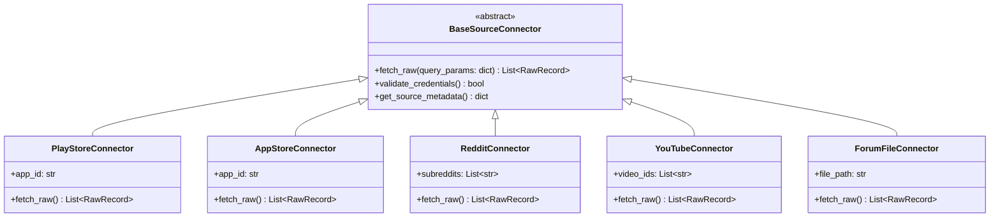

#### Raw Record Schema (Ingestion Contract)
```python
from pydantic import BaseModel, Field, HttpUrl
from typing import Optional, Dict, Any
from datetime import datetime

class RawRecord(BaseModel):
    raw_id: str = Field(description="Unique deterministic ID (e.g. playstore_com.groww_12345)")
    source_platform: str = Field(description="play_store | app_store | reddit | youtube | forum | manual")
    source_url: Optional[str] = Field(default=None, description="Canonical public URL")
    author_id_hash: Optional[str] = Field(default=None, description="Salted SHA-256 hash of author username")
    published_at: Optional[datetime] = Field(default=None, description="Original publication timestamp")
    collected_at: datetime = Field(default_factory=datetime.utcnow)
    raw_text: str = Field(description="Unprocessed text verbatim from source")
    thread_context: Optional[Dict[str, Any]] = Field(default=None, description="Parent post title, video title, etc.")
    product_context: str = Field(default="unknown", description="groww_specific | category_level | other_product_specific | unknown")
```

---

### 3.2 Preprocessing, Deduplication & Qualification Engine

Raw text passes through a four-phase filter pipeline before reaching any LLM:

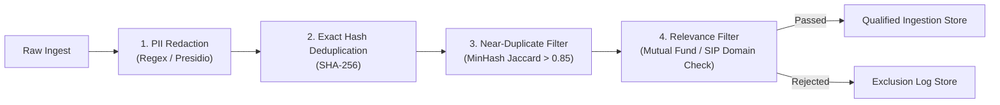

1. **PII Sanitization:**
   * Automated regex and NER masks replace sensitive data:
     * Indian Mobile Numbers: `(?:\+91|91|0)?[6-9]\d{9}` $\rightarrow$ `[REDACTED_PHONE]`
     * Permanent Account Number (PAN): `[A-Z]{5}[0-9]{4}[A-Z]{1}` $\rightarrow$ `[REDACTED_PAN]`
     * Email Addresses: `[a-zA-Z0-9_.+-]+@[a-zA-Z0-9-]+\.[a-zA-Z0-9-.]+` $\rightarrow$ `[REDACTED_EMAIL]`
     * Bank Account Numbers / IFSC Codes $\rightarrow$ `[REDACTED_BANK_INFO]`
2. **Deduplication Engine:**
   * **Exact Duplicates:** Normalized lowercase text passed through SHA-256. Exact duplicates are discarded with hit-counts incremented.
   * **Near-Duplicates / Reposts:** MinHash with Locality Sensitive Hashing (LSH) detecting duplicate bot reviews or syndicated cross-posts (Jaccard similarity threshold: $\ge 0.85$).
3. **Relevance Qualification:**
   * Rule-based keyword matching combined with an optional lightweight zero-shot classifier ensures only conversations relevant to **Mutual Funds, SIPs, Recurring Investments, Portfolio Tracking, NAV, and Rupee Cost Averaging** enter the extraction pipeline.
   * Unrelated discussions (e.g., F&O intraday options bugs, US stocks tax queries, general KYC camera crashes) are routed directly to `exclusion_logs` with a descriptive `exclusion_reason`.

---

### 3.3 LLM Extraction Engine & Guardrails

The extraction engine converts unstructured commentary into structured evidence. It guarantees schema conformance and eliminates hallucinations via programmatic guardrails.

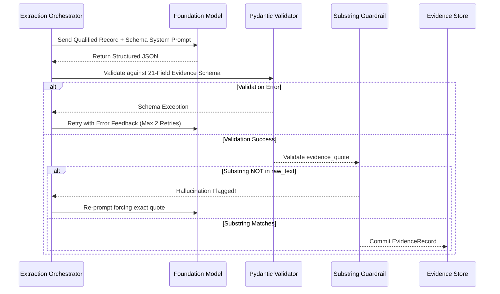

#### Core Evidence Data Model (Pydantic Implementation)
```python
from pydantic import BaseModel, Field, validator
from typing import Optional, List, Literal
from datetime import datetime
import uuid

class EvidenceRecord(BaseModel):
    evidence_id: str = Field(default_factory=lambda: str(uuid.uuid4()))
    source_id: str = Field(description="Foreign key to raw_conversations.raw_id")
    source_platform: Literal["play_store", "app_store", "reddit", "youtube", "forum", "other"]
    source_url: Optional[str] = None
    published_at: Optional[datetime] = None
    product_context: Literal["groww_specific", "category_level", "other_product_specific", "unknown"]
    investor_context: Optional[str] = Field(default=None, description="Explicit stated background")
    journey_stage: Literal[
        "before_starting", "newly_started", "continuing", 
        "considering_change", "paused", "stopped", "unknown"
    ] = "unknown"
    motivation: Optional[str] = None
    expectation: Optional[str] = None
    trigger_or_situation: Optional[str] = None
    reported_behaviour: str = Field(description="Explicit action or habit described")
    friction_or_concern: Optional[str] = None
    monitoring_behaviour: Optional[str] = None
    workaround: Optional[str] = None
    reported_outcome: Optional[str] = None
    evidence_quote: str = Field(description="Shortest verbatim substring supporting the extraction")
    evidence_type: Literal["explicitly_stated", "inferred", "unknown"] = "explicitly_stated"
    missing_information: List[str] = Field(default_factory=list)
    extraction_confidence: float = Field(ge=0.0, le=1.0)
    review_status: Literal["unreviewed", "accepted", "corrected", "rejected"] = "unreviewed"

    @validator("evidence_quote")
    def quote_must_not_be_empty(cls, v):
        if not v or len(v.strip()) < 5:
            raise ValueError("evidence_quote must be an explicit, non-empty excerpt")
        return v
```

#### Substring Verification Algorithm
```python
def verify_verbatim_quote(raw_text: str, evidence_quote: str) -> bool:
    """
    Guarantees zero model hallucination in evidence quotes.
    Normalizes whitespace and checks for exact substring existence.
    """
    clean_raw = " ".join(raw_text.split()).lower()
    clean_quote = " ".join(evidence_quote.split()).lower()
    return clean_quote in clean_raw
```

---

### 3.4 Pattern Discovery & Semantic Clustering Engine

The system uses an unsupervised bottom-up clustering pipeline to discover recurring behavioural patterns without pre-selecting themes:

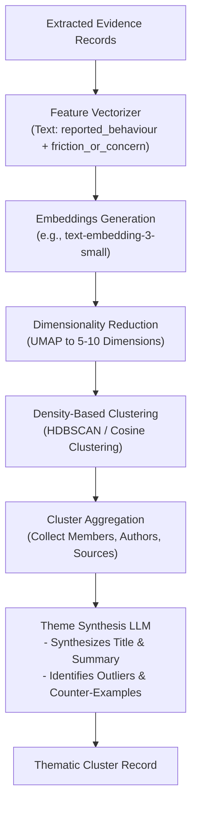

#### Aggregation Metrics per Cluster
* **Dataset Prevalence ($P$):** $\frac{\text{Records in Cluster}}{\text{Total Qualified Records}} \times 100\%$
* **Unique Voice Ratio ($UVR$):** $\frac{\text{Distinct Authors in Cluster}}{\text{Total Records in Cluster}}$ (detects single-user review bombing)
* **Cross-Source Dispersion:** Entropy across source platforms ensuring patterns are not platform artifacts.
* **Counter-Evidence Identification:** Negative semantic distance queries identify users experiencing similar triggers who did *not* develop the friction.

---

### 3.5 Hypothesis Generation & Opportunity Prioritization Engine

To transition from observations to actionable research, the engine generates competing hypotheses and prioritizes opportunities using a transparent multi-dimensional rubric.

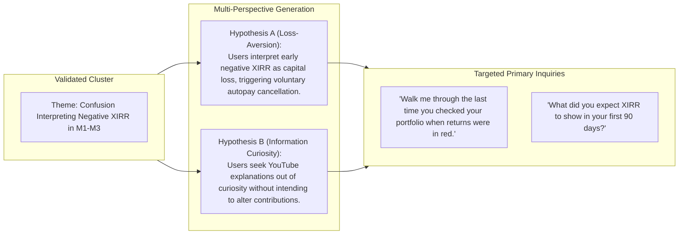

#### The 5-Pillar Opportunity Prioritization Rubric
Each opportunity area $O_i$ receives a transparent qualitative & quantitative score:

$$S(O_i) = w_1 P(O_i) + w_2 I(O_i) + w_3 R_{12M}(O_i) + w_4 Q(O_i) + w_5 A(O_i)$$

Where:
* $P(O_i)$ (**Prevalence**): Proportion of unique authors reporting this pattern in the dataset.
* $I(O_i)$ (**User Impact Severity**): Degree of anxiety or friction expressed (scored from 1 to 5).
* $R_{12M}(O_i)$ (**Relevance to 12M Metric**): Plausible causal relationship with maintaining an active SIP (1 to 5).
* $Q(O_i)$ (**Evidence Quality & Diversity**): Multi-platform corroboration and presence of counter-evidence.
* $A(O_i)$ (**Product Addressability**): Feasibility of solving via Groww UX/Product mechanisms.

> **Important:** The Problem Statement (§10) explicitly states: *"Initially, the system should compare opportunities qualitatively and show the evidence behind each assessment. Avoid assigning arbitrary numerical scores until the criteria and scoring definitions are defensible."* The formula above is an **aspirational target** for later iterations. The V1 implementation must use **qualitative comparison with transparent evidence** rather than opaque numerical ranking.

---

### 3.6 Quality Assurance, Benchmarking & Golden Set Subsystem

This subsystem satisfies the core requirement for an auditable **AI Evidence Log** containing a human-labelled **Golden Set of ~20 items**.

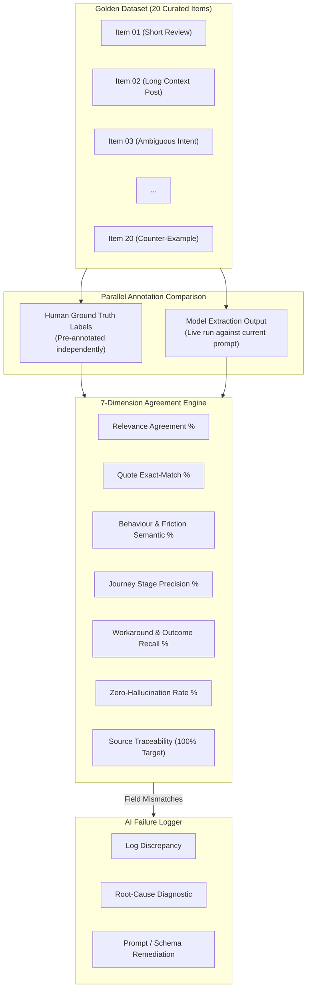

---

## 4. Storage Architecture & Database Schema

The system uses an embedded, zero-maintenance relational engine (**SQLite / DuckDB**) for local execution and pilot testing, which cleanly scales to **PostgreSQL** for multi-user production deployments.

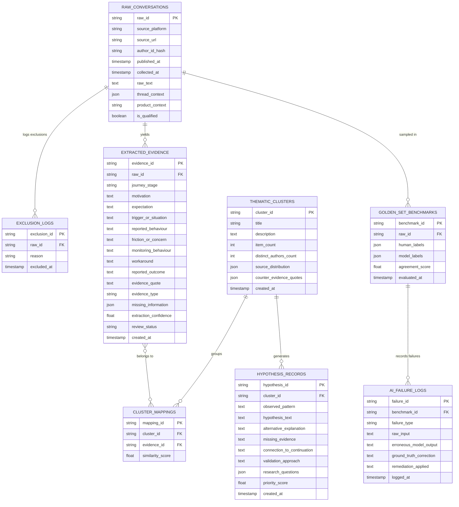

---

## 5. PM Audit & Research Dashboard Architecture

The frontend provides the Growth PM with a clean, evidence-backed workspace for exploring findings, inspecting audits, and exporting deliverables.

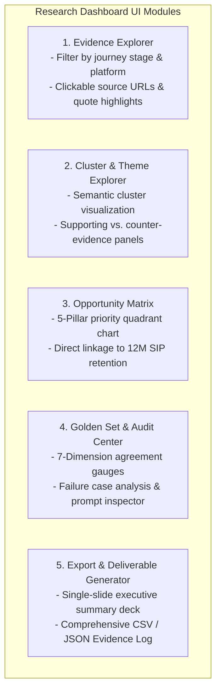

### Dashboard Interaction Contract
1. **Auditable Click-Through:** Selecting any bar in a theme frequency chart immediately isolates the supporting records, showing original quotes alongside platform links.
2. **Interactive Review:** PMs can manually toggle `review_status` (`accepted`, `corrected`, `rejected`) directly within the UI, triggering real-time re-clustering.
3. **One-Slide Deck Generator:** Automates Deliverable 4 by generating a pre-formatted SVG / PDF slide summarizing the ingestion volumes, top 3 emergent themes, competing hypotheses, and next-step interview questions.

---

## 6. Security, Privacy & Advisory Safeguards

| Domain | Threat / Risk | Enforced Architectural Safeguard |
|---|---|---|
| **Privacy & PII** | Leakage of user phone numbers, emails, PAN cards, or portfolio values from public screenshots/text. | Ingestion-level regex sanitization and Presidio NER scrubbers strip all PII before database storage or LLM submission. |
| **Platform Compliance** | IP blocking or ToS violations from automated scraping. | Connectors adhere to rate limits, robots.txt directives, caching headers, and support local offline CSV/JSON imports. |
| **Investment Advice Boundary** | Engine outputs fund recommendations or stock picks. | System prompt system guards forbid financial advisory generation; system operates strictly as an analytical UX research tool. |
| **Dark Patterns** | Recommending FOMO, artificial urgency, or anxiety-inducing nudges. | Hardcoded prompt constraints reject any retention strategy involving artificial countdowns, deceptive cancellation flows, or guilt messaging. |

---

## 7. Directory & Project Structure

The project is structured modularly for maintainability and clear separation of concerns:

```text
Groww-Discovery-Engine/
├── context.md                          # Comprehensive problem context & specification
├── architecture.md                     # System architecture specification (this document)
├── Problem Sataement.txt               # Source assignment document
├── pyproject.toml / requirements.txt   # Python dependency specifications
├── configs/
│   ├── config.yaml                     # Pipeline parameters, model selection, thresholds
│   └── pii_patterns.json               # Regex patterns for phone, PAN, email sanitization
├── data/
│   ├── raw/                            # Ingested, unedited source files (JSON / CSV)
│   ├── processed/                      # Normalized, deduplicated, qualified datasets
│   ├── golden_set/                     # 20 human-labelled benchmark items
│   └── database/                       # Local SQLite / DuckDB storage files
├── src/
│   ├── __init__.py
│   ├── connectors/                     # Ingestion adapters
│   │   ├── base.py                     # BaseSourceConnector abstract class
│   │   ├── play_store.py               # Google Play Store scraper / adapter
│   │   ├── app_store.py                # Apple App Store adapter
│   │   ├── reddit.py                   # Reddit API / Pushshift connector
│   │   ├── youtube.py                  # YouTube Data API comments connector
│   │   └── file_importer.py            # Local CSV / JSON / Excel loader
│   ├── preprocessing/                  # Data cleaning & qualification
│   │   ├── sanitizer.py                # PII masking & text normalization
│   │   ├── deduplicator.py             # SHA-256 & MinHash LSH deduplication
│   │   └── qualifier.py                # Relevance classifier & exclusion logger
│   ├── extraction/                     # LLM evidence extraction
│   │   ├── models.py                   # Pydantic 21-Field EvidenceRecord schema
│   │   ├── prompts.py                  # Structured extraction prompt templates
│   │   ├── orchestrator.py             # LLM API caller with retry logic
│   │   └── guardrails.py               # Substring verbatim quote verification
│   ├── clustering/                     # Semantic pattern discovery
│   │   ├── embedder.py                 # Vector embedding generator
│   │   ├── clusterer.py                # HDBSCAN / UMAP clustering
│   │   └── synthesizer.py              # LLM theme naming & counter-evidence finder
│   ├── hypotheses/                     # Hypotheses & prioritization
│   │   ├── generator.py                # Multi-perspective hypothesis synthesizer
│   │   └── ranker.py                   # 5-Pillar opportunity scoring algorithm
│   ├── evaluation/                     # Golden set benchmarking
│   │   ├── benchmark.py                # 7-dimension agreement evaluator
│   │   └── failure_logger.py           # Automated failure recorder & report generator
│   └── ui/                             # PM audit & exploration interface
│       ├── app.py                      # Web application entry point (Streamlit / FastAPI)
│       ├── components/                 # UI views (Explorer, Clusters, Golden Set)
│       └── exporter.py                 # Findings & Evidence Log export utilities
└── tests/
    ├── test_connectors.py
    ├── test_deduplicator.py
    ├── test_guardrails.py
    ├── test_schema_validation.py
    └── test_evaluator.py
```

---

## 8. Phased Implementation Roadmap

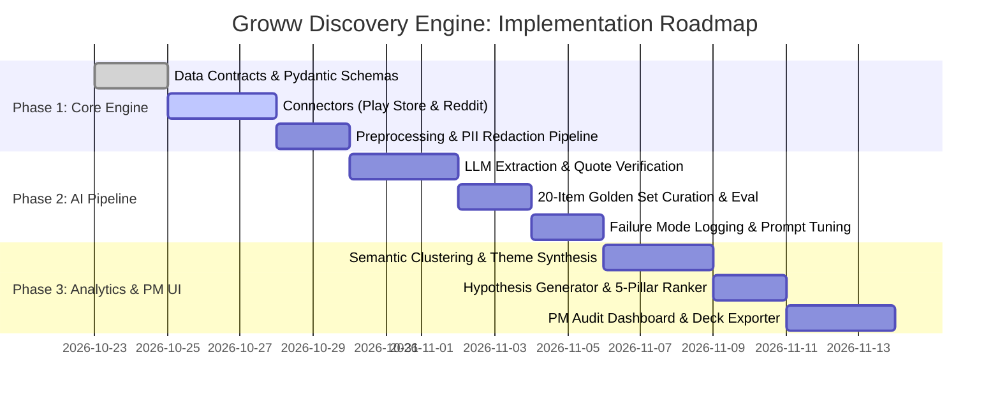

### Milestone Milestones
* **Milestone 1 (Data Foundation):** Ingest 100–200 pilot comments, run through PII redaction and deduplication, and export clean records.
* **Milestone 2 (Auditable Extraction):** Extract structured records using LLM with 100% passing substring verification on quotes.
* **Milestone 3 (Golden Set Benchmark):** Evaluate against 20 human-labelled items, document failure cases, and tune prompts.
* **Milestone 4 (End-to-End Synthesis):** Cluster verified records, generate competing hypotheses, rank opportunities, and generate Deliverables 1–4.
