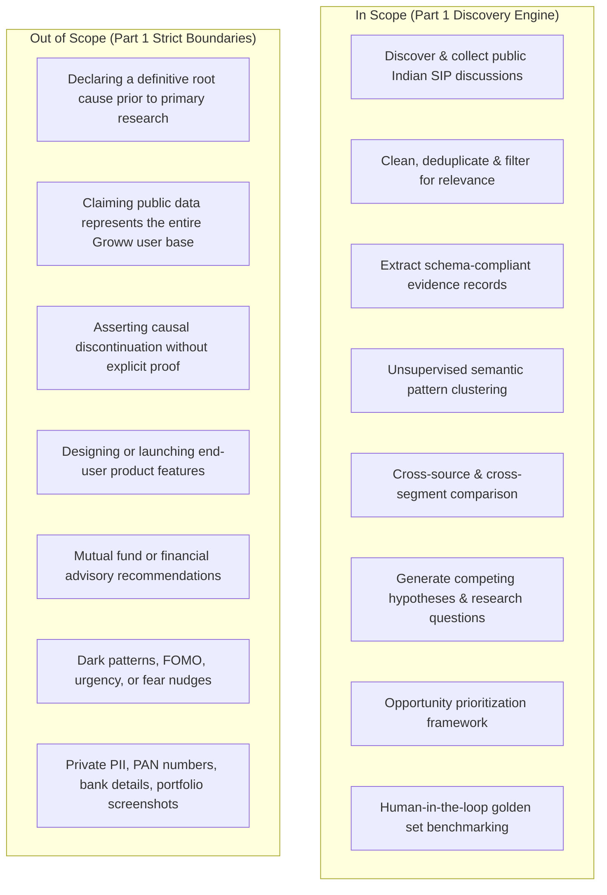
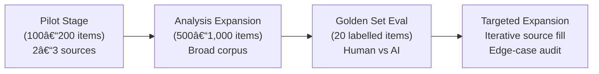
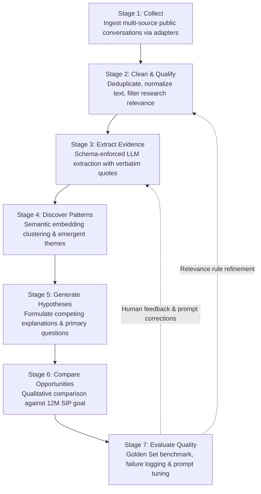
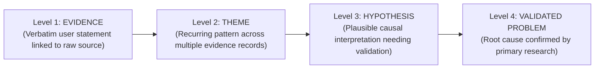
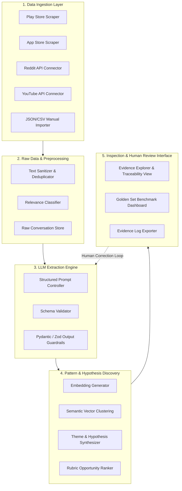
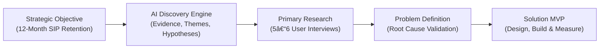

# Groww AI-Powered Discovery Engine — Project Context & Detailed Specification

> **Product:** Groww  
> **Team:** Growth  
> **Project:** AI-Powered Discovery Engine  
> **Target Business Objective:** Increase the percentage of first-time mutual fund investors who maintain an active SIP 12 months after their first contribution.  
> **Source Reference:** [Problem Sataement.txt](file:///d:/SAURABH/Groww%20Discovery%20Engine/Problem%20Sataement.txt)

---

## 1. Executive Summary

Groww seeks to increase the percentage of first-time mutual fund investors who still have an active SIP 12 months after starting their first SIP. However, the root user problem that causes continuation to break down is **unknown** at the outset.

The core discovery challenge is understanding what unfolds between the moment a first-time investor sets up their initial SIP and the subsequent 12 months. Investors experience differing financial circumstances, varying mental models, information needs, concerns, habits, monitoring behaviours, and external sources of advice. Some maintain steady monthly contributions, some pause or reduce instalments, and others cancel or stop entirely. 

Rather than assuming a single root cause (e.g., market decline, app usability, or poor returns), the **AI-Powered Discovery Engine** systematically gathers and analyzes publicly available discussions across the Indian investing ecosystem.

The engine executes an end-to-end pipeline:
1. **Data Collection:** Sourcing public conversations across Play Store, App Store, Reddit, YouTube, and investing forums.
2. **Cleaning & Qualification:** Normalizing text, removing spam/duplicates, and filtering for research relevance.
3. **Structured Evidence Extraction:** Converting unstructured commentary into auditable, schema-compliant records with zero unsupported inferences.
4. **Pattern Discovery:** Semantically clustering experiences to reveal recurring behaviours and unmet needs without forcing predetermined themes.
5. **Cross-Segment Comparison:** Analyzing differences across stated demographics, income stability, and source of influence where explicitly available.
6. **Hypothesis Generation:** Formulating competing, falsifiable hypotheses linked to supporting and contradictory evidence.
7. **Opportunity Assessment:** Prioritizing opportunity areas against the 12-month continuation goal for downstream primary research.
8. **Human Quality Evaluation:** Benchmarking AI extractions against a human-labelled golden dataset to log discrepancies, failure modes, and prompt refinements.

The resulting output is an **evidence-backed research foundation**—auditable data, user verbatims, competing hypotheses, unanswered questions, and targeted interview guides—ready to power primary user research and metric decomposition.

---

## 2. Business Context & Strategic Objective

### 2.1 Strategic Metric & Benchmark
* **Primary Objective:** Increase the percentage of first-time mutual fund investors who retain an **active SIP 12 months after starting their first SIP**.
* **Active SIP Definition:** Having at least **one successful instalment in the trailing 30 days**.
* **Engine’s Role:** The discovery engine itself does not directly shift the continuation metric; it discovers and validates which user problems are most critical to solve to move this metric.

### 2.2 What is Unknown (Zero-Assumption Mandate)
We do not know why continuation breaks down. It is strictly forbidden to anchor on predetermined assumptions such as market volatility, user laziness, UI complexity, or insufficient returns.

The engine is engineered to resolve fundamental discovery questions:
* Why did investors start their first SIP, and what initial outcomes did they expect?
* How did their perceptions, financial situations, or routines change post-onboarding?
* What do they monitor, at what cadence, and what metrics cause confusion?
* What friction, disappointment, or misinterpretations arose during their journey?
* What exact triggers preceded a decision to pause, modify, or terminate a SIP?
* What external workarounds (YouTube, FinTwit/X, Reddit, peer advice) did they use when confused?
* What behavioural differences separate continuing investors from churned investors?
* Which patterns vary systematically across investor segments (income stability, age, decision influence)?
* Which persistent unmet needs can realistically be solved within the product experience?

### 2.3 Core Problem Statement
> **We do not yet have a sufficiently evidence-backed understanding of the behaviours, experiences, circumstances, and unmet needs that shape first-time mutual fund investors' decisions to continue, reduce, pause, or stop their SIPs during the first 12 months.**
>
> Public feedback exists across multiple platforms, but the available conversations may be fragmented, inconsistent, repetitive, incomplete, and difficult to compare. Reading them manually or relying on general-purpose AI summaries may fail to reveal meaningful behavioural sequences, differences between investor segments, contradictory evidence, or the strength of a potential pattern. We need a repeatable, AI-assisted discovery workflow that transforms these conversations into structured, traceable evidence and helps us identify which potential problems deserve further investigation.

---

## 3. Product Vision, Target Persona & Core Promise

### 3.1 Product Vision
Build an AI-powered research discovery platform that empowers Growth Product Managers to transform fragmented public investor discussions into verifiable evidence, behavioural clusters, competing hypotheses, and prioritized research questions.

### 3.2 Target Persona
* **Primary User:** Growth Product Manager at Groww investigating first-time investor retention and SIP health.
* **Secondary Users:** User Researchers, Product Analysts, and Strategy Leads designing onboarding and post-onboarding retention loops.

### 3.3 User Need Statement
> *"I need to understand what investors actually experience after starting a SIP, identify recurring behavioural patterns across diverse public sources, and determine which potential problems deserve deeper research—without relying on assumptions or unverified AI conclusions."*

### 3.4 The 7 Product Promises
For any given public conversation corpus, the engine answers:
1. **Verbatim Reality:** What are investors explicitly saying and doing?
2. **Emergent Patterns:** What behavioural clusters emerge naturally from the data?
3. **Dataset Prevalence:** How frequently do specific friction points occur within the collected corpus?
4. **Context & Stage:** Which journey stages and investor profiles correlate with these friction points?
5. **Divergent Proof:** What evidence supports—and critically, what evidence contradicts—each interpretation?
6. **Epistemic Boundaries:** What remains unknown or underspecified?
7. **Actionable Next Steps:** What specific questions should be investigated via 1:1 primary user interviews?

---

## 4. Scope & System Boundaries



---

## 5. Research Matrix (10 Core Investigation Dimensions)

The engine must extract and analyze evidence across 10 defined research areas while maintaining a strict distinction between reported facts and unverified extrapolation:

| # | Research Dimension | Primary Questions to Investigate | Critical Analytical Distinctions |
|---|---|---|---|
| **1** | **Motivation & Expectations** | Why did the user initiate a SIP? What return expectations, horizons, and goals did they envision? | Initial enthusiasm does not imply accurate risk comprehension. |
| **2** | **Early Experience (M1–M3)** | What did they check, learn, or stumble upon in the first 90 days? | Setting up autopay successfully does not mean the user understands NAV allocation dates. |
| **3** | **Continuing Behaviour** | What habits, mental frameworks, or routines exist among investors who maintain active SIPs? | Continuing a SIP does not mean the user is satisfied; it may reflect inertia or autopay forgetfulness. |
| **4** | **Change in Behaviour** | What events, emotions, or conditions preceded pausing, reducing, or cancelling instalments? | Mentioning a market dip or negative returns does not mean the user stopped their SIP. |
| **5** | **Monitoring Habits** | What metrics do investors check (XIRR, Absolute Return, Daily P&L), at what frequency, and why? | Frequent checking does not automatically correlate with higher churn. |
| **6** | **In-Product Friction** | What UI elements, jargon, payment mandates, or statements cause confusion or frustration? | A general app crash/login error is not necessarily a SIP retention failure. |
| **7** | **Outside-Product Behaviour** | Where do users go when confused? (YouTube, Reddit, WhatsApp, FinTwit, relatives, advisors)? | Seeking external validation reveals gaps in the core product experience. |
| **8** | **Decision Context** | What external financial shocks or life events triggered the modification of the SIP? | Distinguish external cash flow constraints from product-induced distrust. |
| **9** | **Segment Differences** | How do behaviours vary by income type, stability, age, and decision catalyst? | Only classify segments when author explicitly provides data; never guess. |
| **10** | **Unmet Needs** | What persistent gaps, unanswered questions, and emotional anxieties remain unaddressed? | Unmet needs must be grounded in direct user statements. |

---

## 6. Data Sources, Ingestion & Sampling Strategy

### 6.1 Source Mix
1. **Google Play Store Reviews:** High-volume user reviews on Groww covering SIP setup, autopay/mandate execution, portfolio tracking, and customer service.
2. **Apple App Store Reviews:** Cross-platform cohort offering insights into iOS user expectations and feature friction.
3. **Reddit (`r/IndiaInvestments`, `r/mutualfunds`, etc.):** In-depth, contextual narratives regarding first-time investment hurdles, mental models, and decision rationales.
4. **Trading & Investment Forums (TradingQ&A, ValuePickr):** Technical discussions regarding SIP mechanics, taxation, NAV units, and mandate failures.
5. **YouTube Comments:** Grassroots queries and complaints under beginner personal finance tutorials (video metadata captured to preserve discussion context).
6. **Other Public Channels:** Accessible public domain discussions adhering strictly to robots.txt, terms of service, and privacy standards.

### 6.2 Provenance & Context Classification
To prevent false equivalences, all evidence is categorized into one of four product contexts:
* `Groww-specific`: Author explicitly references Groww or proprietary features.
* `Category-level`: Author discusses Indian mutual funds or SIPs without naming a platform.
* `Other-product-specific`: Author references a competing platform (Zerodha Coin, Kuvera, AngelOne, Paytm Money).
* `Unknown`: Platform context cannot be reliably determined.

> [!IMPORTANT]
> Category-level insights provide industry context but **must not** be cited as direct proof of Groww product defects without verification.

### 6.3 Phased Sampling Plan



* **Data Integrity Rule:** Volume counts must reflect actual, deduplicated items collected. If a source yields only 42 valid discussions, report 42—never artificially inflate or fabricate target metrics.

### 6.4 Data Governance & Metadata Tracking
Every harvested conversation must preserve full auditability:
* Platform source & content taxonomy (review, post, top-level comment, reply)
* Unique source identifier & public URL / canonical reference
* Publication timestamp & ingestion timestamp
* Raw verbatim text preserved without editorial alteration
* Contextual metadata (parent post title, video subject, channel name)
* Zero PII storage: Automated scrub of account numbers, phone numbers, email addresses, and names.

---

## 7. End-to-End System Workflow Architecture



### Stage Details:
1. **Stage 1 (Collect):** Pull raw text via connectors/exports; log ingestion failures, API rate limits, query parameters, and date bounds.
2. **Stage 2 (Clean & Qualify):** Normalize whitespace/encoding, detect exact and near-duplicates, filter irrelevant complaints (e.g., F&O options trading issues), log every exclusion with an explicit reason.
3. **Stage 3 (Extract Evidence):** LLM extracts structured records adhering strictly to the schema. If a field is not explicitly present, it is marked `null` / `unknown`. Hallucinations are strictly penalized.
4. **Stage 4 (Discover Patterns):** Unsupervised grouping using vector embeddings followed by LLM-assisted cluster synthesis. Quantifies item frequency, distinct author counts, source spread, and extracts counter-examples.
5. **Stage 5 (Generate Hypotheses):** Develops multi-perspective explanations for observed patterns. Distinguishes competing causal interpretations.
6. **Stage 6 (Compare Opportunities):** Compares opportunity spaces using an objective 5-dimension qualitative rubric.
7. **Stage 7 (Evaluate Quality):** Evaluates AI output against a 20-item human-annotated Golden Set across 7 agreement dimensions.

---

## 8. Structured Evidence Schema (Core Data Contract)

The structured evidence record is the system's foundational contract. Extracted records must strictly adhere to the following schema:

| Field Name | Type | Description / Extraction Constraints |
|---|---|---|
| `evidence_id` | String (UUID) | Unique identifier for the extracted evidence record. |
| `source_id` | String | Original ID from the native platform (e.g., Reddit comment ID, review ID). |
| `source_platform` | Enum | `play_store`, `app_store`, `reddit`, `youtube`, `forum`, `other`. |
| `source_url` | String (URL) | Direct canonical URL to the public record, when available. |
| `published_at` | ISO-8601 String | Timestamp of original user post (or `null` if unavailable). |
| `product_context` | Enum | `groww_specific`, `category_level`, `other_product_specific`, `unknown`. |
| `investor_context` | String / Null | Stated investment experience, initial capital, or explicit portfolio background. |
| `journey_stage` | Enum | `before_starting`, `newly_started`, `continuing`, `considering_change`, `paused`, `stopped`, `unknown`. |
| `motivation` | String / Null | Stated reason for initiating the SIP (wealth creation, tax saving, peer recommendation). |
| `expectation` | String / Null | Explicit anticipated outcome, timeframe, or return threshold mentioned by user. |
| `trigger_or_situation` | String / Null | Specific event/catalyst preceding user concern (market drop, salary delay, app alert). |
| `reported_behaviour` | String | Action the user took, routinely performs, or considered taking. |
| `friction_or_concern` | String / Null | Specific pain point, confusion, doubt, or dissatisfaction experienced. |
| `monitoring_behaviour`| String / Null | Metrics inspected and cadence (e.g., *"checks daily return every morning"*). |
| `workaround` | String / Null | External action taken to resolve confusion (e.g., searched YouTube, asked on Reddit). |
| `reported_outcome` | String / Null | Concrete outcome explicitly stated (e.g., cancelled SIP, changed date, stayed invested). |
| `evidence_quote` | String | **Shortest verbatim substring** from the source text validating the extraction. |
| `evidence_type` | Enum | `explicitly_stated`, `inferred`, `unknown`. |
| `missing_information` | Array[String] | Critical missing context (e.g., `["sip_status_unknown", "fund_type_unspecified"]`). |
| `extraction_confidence`| Float [0.0 - 1.0] | Model's self-reported extraction confidence. |
| `review_status` | Enum | `unreviewed`, `accepted`, `corrected`, `rejected`. |

### The 4 Epistemic Levels of Reasoning



> [!CAUTION]
> The AI Discovery Engine operates exclusively across **Levels 1, 2, and 3**. **Level 4** belongs strictly to subsequent primary research interviews and quantitative validation.

---

## 9. Theme Synthesis & Pattern Discovery Requirements

### 9.1 Discovery Methodology
* **Bottom-Up Clustering:** Embeddings group records by semantic similarity. The LLM then labels the emergent theme based strictly on commonalities.
* **Top-Down Research Mapping:** Candidate themes are cross-referenced against the 10 core research dimensions to evaluate coverage.

### 9.2 Mandatory Theme Anatomy
Every accepted theme must contain:
1. **Title & Summary:** Crisp, descriptive title and operational definition.
2. **Prevalence Metrics:** Number of supporting evidence items and count of unique authors.
3. **Source Breakdown:** Distribution across platforms (e.g., 60% Reddit, 40% Play Store).
4. **Verbatim Anchor Quotes:** Clickable source links and quotes.
5. **Counter-Evidence:** Examples where the pattern failed to occur or users behaved oppositely.
6. **Journey Stage Alignment:** Where in the 12-month lifecycle this theme manifests.
7. **Explicit vs Inferred Delimitation:** Strict separation of observed facts from interpretations.
8. **Primary Hypotheses:** 1–3 falsifiable hypotheses generated from the theme.
9. **Research Questions:** Recommended questions for 1:1 user interviews.

### 9.3 Statistical Integrity & Quantification Rules
* Frequencies describe **only the harvested sample**, not the general population.
* *Permitted Statement:* *"Among the 250 qualified evidence records, 45 (18.0%) explicitly reported confusion interpreting XIRR vs Absolute Returns."*
* *Forbidden Statement:* *"18% of Groww investors do not understand XIRR."*
* Always disclose the denominator, deduplication method, and distinct author count.

### 9.4 Explicit Demographic & Segment Extraction
Segments must only be tagged when explicitly stated by the author:
* **Income Stability:** `stable`, `variable`, `explicitly unstable`, or `unknown`.
* **Source of Money:** `salary`, `business income`, `family support`, `savings`, or other stated source, or `unknown`.
* **Influence:** `self-directed`, `friend`, `family`, `social media`, `financial professional`, or `unknown`.
* **Age Group:** An explicitly stated age or defensible age band, otherwise `unknown`.

Do not infer age, income, or financial circumstances from writing style or other weak signals. Segment comparisons should include unknowns and disclose small sample sizes. If there is insufficient evidence for a comparison, report that gap instead of manufacturing a conclusion.

---

## 10. Hypothesis Formulation & Opportunity Prioritization

### 10.1 Hypothesis Record Schema
For each validated theme, the engine instantiates a hypothesis record:
* **Observed Pattern:** The concrete phenomenon visible across evidence records.
* **Supporting Evidence:** Array of `evidence_id` references and quotes.
* **Alternative Explanations:** Competing hypotheses explaining the same phenomenon.
* **Missing Information:** What data points cannot be proven from public data.
* **Connection to 12-Month SIP Metric:** Proposed mechanism linking the pattern to continuation or churn.
* **Interview Validation Strategy:** Specific inquiry paths for primary research.
* **Confidence & Epistemic Limitations:** Transparent statement of uncertainty.

### 10.2 Opportunity Comparison Framework (5 Criteria)

Once evidence exists, use a transparent comparison framework rather than an opaque AI-generated ranking.

```mermaid
quadrantChart
    title Opportunity Comparison Matrix
    x-axis Low Relevance to 12M Continuation --> High Relevance to 12M Continuation
    y-axis Low Dataset Prevalence --> High Dataset Prevalence
    quadrant-1 High Priority (Immediate Research Focus)
    quadrant-2 Niche / High Friction (Targeted Inquiry)
    quadrant-3 Low Value / Noise (Deprioritize)
    quadrant-4 Broad Sentiment / Low Continuation Impact
```

1. **Prevalence:** How often does the pattern occur in the collected data, and across how many distinct authors and sources?
2. **User Impact:** How important or consequential do affected investors describe the experience to be?
3. **Business Relevance:** Is there evidence of a plausible connection to starting, maintaining, reducing, pausing, or stopping a SIP during the first year?
4. **Evidence Quality:** Are the observations explicit, diverse, traceable, and supported by more than one independent source?
5. **Product Influence:** Is there a plausible way the product experience could address the need, without assuming the solution in advance?

> [!IMPORTANT]
> These criteria are proposed implementation choices, not scoring rules supplied by the assignment. Initially, the system should compare opportunities **qualitatively** and show the evidence behind each assessment. Avoid assigning arbitrary numerical scores until the criteria and scoring definitions are defensible.

---

## 11. AI Evidence Log & Evaluation Benchmark (Golden Set)

The assignment requires an **AI Evidence Log** containing a human-labelled **Golden Set of ~20 items** to audit extraction fidelity and benchmark accuracy.

### 11.1 Golden Set Composition
* 20 manually curated public comments reflecting diverse lengths, platforms, sentiments, and ambiguities.
* Human ground-truth annotations established *prior to* viewing AI extractions.

### 11.2 Evaluation Rubric (7 Dimensions of Agreement)

| Dimension | Evaluation Question | Success Metric |
|---|---|---|
| **1. Relevance Classification** | Did the model correctly include or exclude the item from the research scope? | % Agreement |
| **2. Verbatim Quote Accuracy** | Does `evidence_quote` match an exact, unedited substring of the source? | Exact Match % |
| **3. Behaviour & Friction** | Did it accurately isolate reported behaviour and concern without adding bias? | Semantic Agreement % |
| **4. Journey Stage Assignment**| Did it select the correct stage or appropriately mark it `unknown`? | Stage Match % |
| **5. Workaround & Outcome** | Did it extract workarounds/outcomes only when explicitly stated? | Precision % |
| **6. Zero Hallucination Rate** | Did the model fabricate any motivation, emotion, or causal link? | Hallucination-Free % |
| **7. Provenance Traceability** | Does the output trace back to the correct source URL and ID? | 100% Deterministic |

### 11.3 AI Failure Case Documentation (Mandatory Deliverable)
The project documentation must detail **2 to 3 real AI failure modes** encountered during development:
* **Failure Instance:** Verbatim source item text.
* **AI Erroneous Output:** What the LLM incorrectly extracted or inferred.
* **Human Correction:** The accurate ground-truth representation.
* **Root Cause Analysis:** Why the prompt or model failed (e.g., conflating correlation with causation).
* **System Remediation:** The prompt modification, schema change, or guardrail implemented to eliminate the error.

---

## 12. Technical Architecture & Implementation Stack



* **Model Agnostic Principle:** Works across OpenAI (GPT-4o/mini), Anthropic (Claude 3.5 Sonnet), Google (Gemini 1.5/2.0), or open-source local LLMs.
* **RAG Guidance:** Retrieval-Augmented Generation is used for rapid semantic query lookups across extracted records—not as a substitute for structured extraction.

---

## 13. Functional Requirements (FR) Traceability Matrix

| ID | Requirement Specification | Priority | Status |
|---|---|---|---|
| **FR-01** | Ingest public conversations via connectors, exports, or manual CSV/JSON imports. | **MUST** | Core Scope |
| **FR-02** | Retain original text, timestamps, author metadata, and canonical links. | **MUST** | Core Scope |
| **FR-03** | Normalize text encoding, trim noise, and eliminate duplicate records. | **MUST** | Core Scope |
| **FR-04** | Filter out non-SIP/irrelevant discussions with logged exclusion rationale. | **MUST** | Core Scope |
| **FR-05** | Extract structured behavioural evidence using the 21-field data contract. | **MUST** | Core Scope |
| **FR-06** | Preserve `null` / `unknown` values rather than guessing missing attributes. | **MUST** | Core Scope |
| **FR-07** | Link every evidence record deterministically to its source artifact. | **MUST** | Core Scope |
| **FR-08** | Group evidence into emergent clusters via semantic vector similarity. | **MUST** | Core Scope |
| **FR-09** | Display both supporting evidence and contradictory counter-examples for each theme. | **MUST** | Core Scope |
| **FR-10** | Tabulate frequencies and cross-tabulate segments where data is explicitly present. | **MUST** | Core Scope |
| **FR-11** | Generate multi-perspective hypotheses and targeted primary interview guides. | **MUST** | Core Scope |
| **FR-12** | Prioritize opportunity spaces using the 5-dimension qualitative rubric. | **MUST** | Core Scope |
| **FR-13** | Benchmark AI extraction against the 20-item human-labelled Golden Set. | **MUST** | Core Scope |
| **FR-14** | Maintain an audit trail of human corrections, rejected extractions, and model errors. | **MUST** | Core Scope |
| **FR-15** | Export discovery findings and the comprehensive AI Evidence Log. | **MUST** | Core Scope |
| **FR-16** | Continuous automated real-time stream ingestion. | *LATER* | Future Roadmap |
| **FR-17** | Advanced multi-dimensional cohort predictive analytics dashboard. | *LATER* | Future Roadmap |

---

## 14. Non-Functional Requirements & Guardrails

* **Traceability & Provenance:** Every claim, theme, and hypothesis must link directly to the underlying verbatim quote and source ID.
* **Reproducibility:** Pipeline configurations, model parameters (temperature, model version), and prompt templates must be versioned and reproducible.
* **Epistemic Humility:** The system must surface missing information and flag ambiguity rather than forcing speculative certainty.
* **Data Privacy:** Publicly accessible data only. Automatic detection and redaction of PII (PAN, phone, Aadhaar, email, bank account details).
* **Advisory Safeguard:** The engine is purely a diagnostic research system. It must never output financial advice, fund picks, or buy/sell recommendations.
* **Failure Transparency:** Ingestion timeouts, JSON schema validation errors, and API rejections must be logged in an audit file without crashing the pipeline.

---

## 15. Success Criteria & Definition of Done (DoD)

The discovery engine is complete when all the following conditions are satisfied:
- [ ] A working discovery workflow can be run and demonstrated.
- [ ] Public sources, collection methods, date ranges, and actual data volumes are documented.
- [ ] Cleaning and relevance filtering are demonstrated, with exclusions and duplicates accounted for.
- [ ] Relevant conversations are transformed into structured evidence records.
- [ ] Evidence records can be traced to their source items.
- [ ] Candidate themes include supporting evidence and contradictory examples where available.
- [ ] Counts are calculated from the actual dataset and not presented as population-level estimates.
- [ ] Segment comparisons are made only when the data supports them.
- [ ] The engine produces hypotheses and research questions rather than asserting unverified root causes.
- [ ] Potential opportunities are compared transparently against the business objective.
- [ ] A golden set of about 20 manually labelled items is evaluated.
- [ ] The evaluation records agreement and failure cases.
- [ ] Two to three actual examples of corrected or rejected AI outputs are documented.
- [ ] The workflow can be tested by another person, and the findings can be shared.

The assignment does not define a minimum accuracy percentage for the golden set. We should establish and report measured performance honestly rather than inventing a target and claiming it has been achieved.

---

## 16. Key Risks & Mitigation Framework

| # | Identified Risk | Impact / Failure Mode | Engineering & Research Mitigation |
|---|---|---|---|
| **1** | **Public Channel Bias** | Vocal forum users may not reflect the silent majority of Groww SIP investors. | Explicitly document source distributions; forbid generalizing to all Groww users. |
| **2** | **Sparse Continuation Data** | Many comments express frustration without confirming whether the SIP was stopped. | Mandate `journey_stage = unknown`; formulate interview questions to validate actual churn. |
| **3** | **Spurious Causality** | Mistaking correlation (e.g., market dip mention) for the root cause of SIP cancellation. | Enforce 4 Epistemic Levels: isolate Evidence from Theme and Hypothesis. |
| **4** | **LLM Hallucinations** | Model invents investor motivations, portfolio details, or life circumstances. | Enforce strict Pydantic/Zod schema validation; require verbatim substring checks. |
| **5** | **Astroturfing & Bot Floods** | Coordinated spam or affiliate marketing skewing pattern counts. | Implement text deduplication, similarity thresholds, and track unique author IDs. |
| **6** | **Over-Clustering** | Distinct subtle problems merged into a single vague theme (e.g., "App Confusion"). | Inspect cluster variance; enforce maximum semantic radius and capture counter-examples. |
| **7** | **Demographic Inference Errors** | Guessing age/income from vocabulary, introducing socio-economic bias. | Strictly forbid inference on demographic fields; force `unknown` default. |
| **8** | **Source Access Restrictions** | Platform rate-limiting or anti-scraping policies blocking collection. | Modular adapters supporting permitted official APIs and local manual JSON/CSV imports. |
| **9** | **Model Overconfidence** | LLM asserting speculative hypotheses as established facts. | Require explicit confidence ratings and mandatory human sign-off on top themes. |

---

## 17. Project Deliverables

1. **Deliverable 1: Working AI Discovery Engine**  
   A functional, reproducible software pipeline that ingests raw public conversations, cleans the corpus, extracts schema-conforming evidence, clusters patterns, and synthesizes hypotheses.
2. **Deliverable 2: Discovery Findings Report**  
   A structured compilation of extracted evidence, thematic clusters with prevalence counts, segment comparisons, counter-examples, competing hypotheses, and prioritized research questions.
3. **Deliverable 3: AI Evidence Log & Evaluation Benchmark**  
   Documentation of source data volumes, the 20-item human-annotated Golden Set, agreement metrics across 7 dimensions, and 2–3 documented AI failure cases with workflow remediations.
4. **Deliverable 4: One-Slide System Architecture Summary**  
   A high-impact, executive-ready conceptual diagram illustrating data ingestion, evidence extraction, theme clustering, hypothesis formulation, and human quality control.

---

## 18. Strategic Handoff: The Discovery-to-Product Pipeline

The AI Discovery Engine provides the investigative foundation that informs subsequent product development stages:



> [!NOTE]
> The crucial handoff from Part 1 is **not** an automated verdict stating *"Investors churn because of X"*. It is an auditable, high-confidence shortlist of candidate problems, backed by real voices, qualified by counter-evidence, and paired with interview scripts to uncover the truth during primary research.

---

## 19. Recommended Phased Build Plan (Senior PM Guidance)

1. **Phase 1: Contract & Schema Definition:** Lock the 21-field evidence schema and classification rules before writing model prompts.
2. **Phase 2: Pilot Ingestion (100–200 items):** Collect a small real-world pilot sample across Play Store and Reddit to test connectors.
3. **Phase 3: Cleaning & Qualification Pipeline:** Build deduplication and relevance filtering; verify exclusion logging.
4. **Phase 4: Structured LLM Extraction:** Deploy prompt chains with verbatim quote verification and schema validation.
5. **Phase 5: Golden Set Benchmark (20 items):** Human-label 20 items, run evaluation, calculate agreement rates, and document failure cases.
6. **Phase 6: Pattern Clustering & Thematic Discovery:** Cluster verified records using vector embeddings; synthesize themes and extract counter-evidence.
7. **Phase 7: Hypothesis Generation & Rubric Prioritization:** Synthesize competing hypotheses and apply the 5-dimension opportunity rubric.
8. **Phase 8: Deliverable Synthesis & Reporting:** Export discovery findings, the AI Evidence Log, and the executive one-slide workflow diagram.
