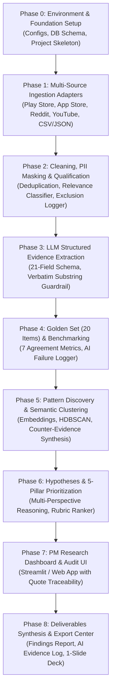
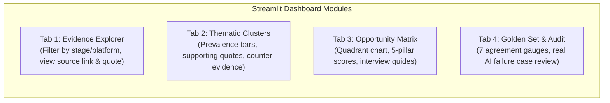

# Phase-Wise Implementation Plan: Groww AI-Powered Discovery Engine

> **Document Type:** Step-by-Step Implementation Roadmap & Engineering Playbook  
> **Target Strategic Metric:** 12-Month First-Time Mutual Fund SIP Continuation Rate  
> **Source References:** [context.md](file:///d:/SAURABH/Groww%20Discovery%20Engine/context.md) | [architecture.md](file:///d:/SAURABH/Groww%20Discovery%20Engine/architecture.md) | [Problem Sataement.txt](file:///d:/SAURABH/Groww%20Discovery%20Engine/Problem%20Sataement.txt)  
> **Author:** Growth Engineering Team (Groww)  

---

## 1. Overview & Phased Implementation Strategy

This document provides an actionable, chronological implementation roadmap for building the **Groww AI-Powered Discovery Engine**. The system is partitioned into **9 sequential phases** (Phase 0 through Phase 8). Each phase contains:
* **Specific Objectives & Dependencies**
* **Concrete File Targets & Directory Paths**
* **Detailed Code Contracts & Implementation Blueprints**
* **Verification & Acceptance Test Criteria**
* **Output Artifacts**



### 1.1 Alignment with Problem Statement: Pipeline Stages vs. Build Phases

The Problem Statement defines **7 pipeline stages** (§7) and a **recommended 8-step build order** (§19). This implementation plan maps directly to those requirements:

| Problem Statement §7 Stage | Recommended Build Step (§19) | Implementation Phase | Role & Scope |
|---|---|---|---|
| *Foundation & Pre-requisite* | Step 1: Define data schema & evidence rules | **Phase 0** | Project scaffold, SQLite schema, Pydantic contracts |
| **Stage 1:** Collect public conversations | Step 2: Collect pilot dataset | **Phase 1** | Ingestion adapters (Play Store, App Store, Reddit, YouTube, CSV) |
| **Stage 2:** Clean and qualify data | Step 3: Cleaning & relevance filtering | **Phase 2** | Deduplication, PII masking, qualification & exclusion logger |
| **Stage 3:** Extract evidence | Step 4: Structured LLM extraction | **Phase 3** | 21-field extraction, verbatim substring guardrail |
| **Stage 7:** Evaluate quality & AI Evidence Log | Step 5 & 6: Inspect records & Golden Set | **Phase 4** | 20-item Golden Set, 7 agreement metrics, failure logger (TDD quality gate) |
| **Stage 4:** Discover patterns and themes | Step 7: Grounded theme discovery | **Phase 5** | Semantic clustering, counter-evidence extraction, distinct author counts |
| **Stage 5 & 6:** Hypotheses & Opportunity Comparison | Step 7 & 8: Hypotheses & opportunity comparison | **Phase 6** | Competing hypotheses, interview guide synthesis, 5-pillar qualitative rubric |
| *Presentation Layer* | *Dashboard & Verification* | **Phase 7** | Streamlit Growth PM research workspace (traceability & review) |
| *Part 1 Mandated Deliverables* | Step 8: Export required deliverables | **Phase 8** | Deliverables 1–4 package synthesis (codebase, findings, evidence log, 1-slide) |

> [!NOTE]
> **Why Phase 4 precedes Phase 5:** Following the Senior PM recommendation in Problem Statement §19, Phase 4 (Golden Set Evaluation) is built *immediately after* Phase 3 (Extraction) as a quality harness. This ensures prompts and extraction fidelity are benchmarked and verified against human ground truth before clustering and hypothesis generation are built on top of the extracted data.

---

## Phase 0: Environment Setup, Architectural Foundation & Core Data Contracts

### 0.1 Objective
Establish the repository structure, Python virtual environment, dependencies, configuration files, and initialize the local SQLite database schema.

### 0.2 Target Files & Directory Layout
```text
Groww-Discovery-Engine/
├── pyproject.toml
├── requirements.txt
├── .env.example
├── configs/
│   ├── config.yaml
│   └── pii_patterns.json
├── data/
│   ├── raw/
│   ├── processed/
│   ├── golden_set/
│   └── database/
├── src/
│   ├── __init__.py
│   └── database/
│       ├── __init__.py
│       ├── connection.py
│       └── schema.sql
└── tests/
    ├── __init__.py
    └── test_database.py
```

### 0.3 Implementation Details

#### 1. Dependencies (`requirements.txt`)
```text
pydantic>=2.5.0
pydantic-settings>=2.1.0
sqlite3-api>=0.1.0
google-play-scraper>=1.2.4
app-store-scraper>=0.3.5
praw>=7.7.1
google-api-python-client>=2.100.0
openai>=1.12.0
anthropic>=0.18.0
tiktoken>=0.5.2
numpy>=1.24.3
pandas>=2.1.0
scikit-learn>=1.3.0
sentence-transformers>=2.2.2
umap-learn>=0.5.4
hdbscan>=0.8.33
streamlit>=1.31.0
plotly>=5.18.0
rich>=13.7.0
pytest>=7.4.0
pyyaml>=6.0.1
```

#### 2. Configuration (`configs/config.yaml`)
```yaml
app:
  name: "Groww Discovery Engine"
  version: "1.0.0"
  environment: "development"

database:
  path: "data/database/discovery_engine.db"

ingestion:
  play_store:
    app_id: "com.nextbillion.groww"
    lang: "en"
    country: "in"
    default_count: 200
  reddit:
    subreddits: ["IndiaInvestments", "mutualfunds", "IndianStockMarket"]
    search_queries: ["first sip", "sip review", "stop sip", "pause sip", "xirr confusion"]
    limit_per_query: 50
  youtube:
    queries: ["first time mutual fund sip india", "how to choose sip groww"]
    max_results: 100

extraction:
  model_provider: "openai" # "openai" | "anthropic" | "gemini"
  model_name: "gpt-4o-mini"
  temperature: 0.0
  max_retries: 2
  quote_guardrail_enforced: true

clustering:
  embedding_model: "sentence-transformers/all-MiniLM-L6-v2"
  min_cluster_size: 3
  metric: "cosine"
```

#### 3. Database Initializer (`src/database/schema.sql`)
Execute SQLite DDL script creating all tables detailed in [architecture.md](file:///d:/SAURABH/Groww%20Discovery%20Engine/architecture.md#4-storage-architecture--database-schema):
* `raw_conversations`
* `exclusion_logs`
* `extracted_evidence`
* `thematic_clusters`
* `cluster_mappings`
* `hypothesis_records`
* `golden_set_benchmarks`
* `ai_failure_logs`

### 0.4 Verification & Exit Criteria
- [ ] Virtual environment activated and all packages installed with zero dependency conflicts.
- [ ] `src/database/connection.py` runs migrations and generates `data/database/discovery_engine.db`.
- [ ] Unit test `pytest tests/test_database.py` validates CRUD operations on all 8 tables.

---

## Phase 1: Multi-Source Data Ingestion Adapters

### 1.1 Objective
Implement modular, robust ingestion adapters for Google Play Store, Apple App Store, Reddit, YouTube comments, and local CSV/JSON file imports. Standardize all incoming conversations into the immutable `RawRecord` schema.

### 1.2 Target Files
```text
src/connectors/
├── __init__.py
├── base.py
├── play_store.py
├── app_store.py
├── reddit.py
├── youtube.py
└── file_importer.py
tests/
└── test_connectors.py
```

### 1.3 Implementation Details

#### 1. Connector Base Class (`src/connectors/base.py`)
```python
from abc import ABC, abstractmethod
from typing import List, Dict, Any
from pydantic import BaseModel, Field
from datetime import datetime
import hashlib

class RawRecord(BaseModel):
    raw_id: str
    source_platform: str
    source_url: str | None = None
    author_id_hash: str | None = None
    published_at: datetime | None = None
    collected_at: datetime = Field(default_factory=datetime.utcnow)
    raw_text: str
    thread_context: Dict[str, Any] | None = None
    product_context: str = "unknown"

class BaseSourceConnector(ABC):
    def __init__(self, config: Dict[str, Any]):
        self.config = config

    @abstractmethod
    def fetch_records(self, **kwargs) -> List[RawRecord]:
        """Fetch raw items and normalize to RawRecord objects."""
        pass

    def hash_author(self, author_name: str | None) -> str | None:
        if not author_name:
            return None
        salt = self.config.get("salt", "groww_discovery_salt")
        return hashlib.sha256(f"{salt}_{author_name}".encode()).hexdigest()[:16]
```

#### 2. Specific Connectors:
* **Play Store (`play_store.py`):** Uses `google-play-scraper` to pull reviews sorted by newest and most relevant; marks `product_context="groww_specific"`.
* **App Store (`app_store.py`):** Uses `app-store-scraper` to pull iOS Groww app reviews.
* **Reddit (`reddit.py`):** Uses `praw` to search targeted subreddits (`r/IndiaInvestments`, `r/mutualfunds`); captures submission title as `thread_context["parent_title"]`.
* **YouTube (`youtube.py`):** Uses YouTube Data API v3 to fetch comments from top Indian personal finance SIP videos; sets video title as `thread_context["video_title"]`.
* **File Importer (`file_importer.py`):** Ingests local CSV/JSON/Excel exports for offline reproducibility.

### 1.4 Verification & Exit Criteria
- [ ] Run pilot extraction: Collect 50 items from Play Store and 50 items from Reddit.
- [ ] All records validate against `RawRecord` without missing fields.
- [ ] Connectors handle network timeouts and rate limits gracefully with log entries.

---

## Phase 2: Cleaning, PII Masking & Relevance Qualification Pipeline

### 2.1 Objective
Purge sensitive PII (PAN, phone, emails, bank accounts), remove exact and near-duplicates, and filter out irrelevant conversations (e.g., F&O intraday bugs, US stocks tax queries), logging every exclusion.

### 2.2 Target Files
```text
src/preprocessing/
├── __init__.py
├── sanitizer.py
├── deduplicator.py
├── qualifier.py
└── pipeline.py
tests/
└── test_preprocessing.py
```

### 2.3 Implementation Details

#### 1. PII Sanitizer (`src/preprocessing/sanitizer.py`)
* Implements compiled regex patterns:
  * Mobile: `(?:\+91|91|0)?[6-9]\d{9}` $\rightarrow$ `[REDACTED_PHONE]`
  * PAN: `[A-Z]{5}[0-9]{4}[A-Z]{1}` $\rightarrow$ `[REDACTED_PAN]`
  * Email: `[a-zA-Z0-9_.+-]+@[a-zA-Z0-9-]+\.[a-zA-Z0-9-.]+` $\rightarrow$ `[REDACTED_EMAIL]`
  * Bank Account / IFSC $\rightarrow$ `[REDACTED_BANK_INFO]`
* Strips excessive whitespace and unreadable Unicode artifacts.

#### 2. Deduplicator (`src/preprocessing/deduplicator.py`)
* **Exact Duplicate:** Normalized text $\rightarrow$ SHA-256 hash. If hash exists in the cache, drop record and increment duplicate counter.
* **Near-Duplicate:** Character 3-gram MinHash with Jaccard threshold $\ge 0.85$ to detect bot reviews and reposted forum discussions.

#### 3. Relevance Classifier & Exclusion Logger (`src/preprocessing/qualifier.py`)
```python
RELEVANT_KEYWORDS = [
    "sip", "instalment", "installment", "mutual fund", "nav", "portfolio",
    "xirr", "cagr", "autopay", "mandate", "step up", "equity", "debt",
    "stop", "pause", "cancel", "deduction", "return", "first time"
]

EXCLUSION_KEYWORDS = [
    "f&o", "call option", "put option", "intraday", "future", "us stocks",
    "nasdaq", "crypto", "bitcoin", "bse index option", "margin trading"
]

def qualify_record(text: str) -> tuple[bool, str | None]:
    lower_text = text.lower()
    for excl in EXCLUSION_KEYWORDS:
        if excl in lower_text:
            return False, f"Irrelevant domain: contains '{excl}'"
    has_relevant = any(rel in lower_text for rel in RELEVANT_KEYWORDS)
    if not has_relevant:
        return False, "No SIP/Mutual Fund terminology detected"
    if len(text.strip().split()) < 4:
        return False, "Insufficient context (< 4 words)"
    return True, None
```

### 2.4 Verification & Exit Criteria
- [ ] Synthetic test suite with fake PAN/phone numbers confirms 100% PII scrubbing.
- [ ] Duplicate text strings are dropped deterministically.
- [ ] Non-SIP complaints are logged in `exclusion_logs` with explicit reasons.
- [ ] Qualified records are committed to `raw_conversations` with `is_qualified=True`.

---

## Phase 3: Structured LLM Evidence Extraction Engine & Guardrails

### 3.1 Objective
Convert qualified raw conversations into structured, schema-compliant `EvidenceRecord` instances adhering strictly to the 21-field data contract. Enforce the **Zero-Hallucination Quote Guardrail** via deterministic substring verification.

### 3.2 Target Files
```text
src/extraction/
├── __init__.py
├── models.py
├── prompts.py
├── guardrails.py
└── orchestrator.py
tests/
└── test_extraction.py
```

### 3.3 Implementation Details

#### 1. Evidence Data Contract (`src/extraction/models.py`)
Implements the 21-field Pydantic `EvidenceRecord` specification defined in [architecture.md](file:///d:/SAURABH/Groww%20Discovery%20Engine/architecture.md#core-evidence-data-model-pydantic-implementation).
* Unknown values strictly default to `None` or `"unknown"`—guessing is prohibited.
* Enforces `evidence_quote` validation.

#### 2. Extraction System Prompt (`src/extraction/prompts.py`)
```text
You are an expert qualitative research system for Groww's Growth Team.
Your objective is to extract verifiable behavioural evidence regarding first-time mutual fund SIP investors.

CRITICAL EXTRACTION RULES:
1. ONLY extract what the author EXPLICITLY states. Never assume, infer, or speculate.
2. If an attribute (e.g. income stability, journey stage, motivation) is not stated, mark it as null or "unknown".
3. evidence_quote MUST be an EXACT, contiguous substring copied verbatim from the user's text.
4. Do NOT conflate mentions of market drops with stopping a SIP unless the author explicitly states they stopped or paused.
5. Do NOT provide financial advice. Output pure structured JSON conforming to the schema.
```

#### 3. Verbatim Quote Guardrail (`src/extraction/guardrails.py`)
```python
def validate_substring(raw_text: str, quote: str) -> bool:
    clean_raw = " ".join(raw_text.split()).lower()
    clean_quote = " ".join(quote.split()).lower()
    return clean_quote in clean_raw
```
If `validate_substring` evaluates to `False`, the orchestrator automatically re-prompts the model with:
> *"The provided evidence_quote was not found in the original source text. Extract ONLY an exact verbatim substring."*

### 3.4 Verification & Exit Criteria
- [ ] Run extraction across 50 qualified records.
- [ ] 100% of generated records pass Pydantic schema validation.
- [ ] 100% of `evidence_quote` entries are confirmed exact substrings of the source text.
- [ ] Extracted records are saved to `extracted_evidence` in the SQLite database.

---

## Phase 4: Golden Set (20 Items), Evaluation Benchmarking & Failure Logging

### 4.1 Objective
Construct the mandatory human-labelled **Golden Set of ~20 items**, benchmark the LLM extraction across 7 dimensions of agreement, and establish the **AI Failure Logger** to document real failure modes and prompt refinements.

### 4.2 Target Files
```text
data/golden_set/
├── golden_set_source.json
└── golden_set_human_labels.json
src/evaluation/
├── __init__.py
├── benchmark.py
├── failure_logger.py
└── metrics.py
tests/
└── test_evaluation.py
```

### 4.3 Implementation Details

#### 1. Golden Set Curation (`data/golden_set/`)
Curate 20 diverse items from the ingested corpus:
* 5 Google Play Store reviews (mix of short, critical, positive)
* 5 Reddit posts/comments (detailed context, workarounds)
* 4 YouTube comments (clarification queries)
* 3 Ambiguous/noisy comments (edge cases)
* 3 Counter-examples (investors continuing despite market drops)

Human ground-truth annotations are created independently in `golden_set_human_labels.json`.

#### 2. The 7 Agreement Dimensions Evaluator (`src/evaluation/benchmark.py`)
Evaluates model extractions against ground truth:
1. **Relevance Classification Agreement:** Exact match %
2. **Verbatim Quote Exactness:** Substring match %
3. **Behaviour & Friction Agreement:** Semantic similarity (embedding cosine $> 0.82$)
4. **Journey Stage Accuracy:** Exact enum match %
5. **Workaround & Outcome Extraction:** Precision / Recall
6. **Zero-Hallucination Rate:** % of records with 0 unsupported inferences
7. **Source Traceability:** Deterministic link back to source ID (100% requirement)

#### 3. AI Failure Logger (`src/evaluation/failure_logger.py`)
For any mismatch (e.g., model marked `journey_stage="stopped"` when the text only stated *"returns are low"*):
* Records: `raw_input`, `erroneous_output`, `human_ground_truth`, `failure_type`, `root_cause`.
* Stores failure records in `ai_failure_logs` for inclusion in Deliverable 3 (AI Evidence Log).

### 4.4 Verification & Exit Criteria
- [ ] Golden Set of 20 items fully compiled with human ground-truth labels.
- [ ] Automated benchmark script executes and outputs the 7 agreement percentages.
- [ ] At least 2–3 genuine AI failure cases are identified, logged, and paired with prompt fixes.

---

## Phase 5: Pattern Discovery, Semantic Clustering & Counter-Evidence Synthesis

### 5.1 Objective
Implement unsupervised semantic clustering over extracted evidence to discover recurring behavioural patterns without imposing predefined themes. Calculate dataset prevalence, unique author ratios, and surface contradictory counter-examples.

### 5.2 Target Files
```text
src/clustering/
├── __init__.py
├── embedder.py
├── clusterer.py
├── synthesizer.py
└── analyzer.py
tests/
└── test_clustering.py
```

### 5.3 Implementation Details

#### 1. Embeddings & Dimensionality Reduction (`src/clustering/embedder.py` & `clusterer.py`)
* Combines `reported_behaviour` + `friction_or_concern` into a feature text.
* Generates dense vectors using `sentence-transformers/all-MiniLM-L6-v2`.
* Reduces dimensions via UMAP ($n\_components=5$, $metric='cosine'$).
* Clusters using HDBSCAN ($min\_cluster\_size=3$, $min\_samples=2$).

#### 2. Theme Synthesizer & Counter-Evidence (`src/clustering/synthesizer.py`)
For each dense cluster:
* Computes:
  * **Item Count**
  * **Distinct Author Count** (using `author_id_hash`)
  * **Source Platform Distribution**
* Prompts the LLM to generate:
  * A concise, descriptive **Theme Title**
  * An operational **Thematic Description**
  * Supporting verbatim quotes
* **Counter-Evidence Search:** Identifies outlier records in the dataset that experienced the same trigger (e.g., market decline) but reported opposite behaviour (e.g., staying invested or stepping up instalments).

### 5.4 Verification & Exit Criteria
- [ ] Validated clustering runs over the qualified corpus ($\ge 100$ records).
- [ ] Clusters output unique author counts and platform distributions.
- [ ] Emergent themes include both supporting quotes and contradictory counter-examples.
- [ ] Results saved to `thematic_clusters` and `cluster_mappings`.

---

## Phase 6: Hypotheses Generation & 5-Pillar Opportunity Prioritization

### 6.1 Objective
Formulate competing, falsifiable hypotheses for each emergent theme, synthesize targeted primary interview guides, and rank opportunities using the transparent 5-pillar qualitative rubric.

### 6.2 Target Files
```text
src/hypotheses/
├── __init__.py
├── generator.py
├── ranker.py
└── interview_guides.py
tests/
└── test_hypotheses.py
```

### 6.3 Implementation Details

#### 1. Multi-Perspective Hypothesis Generator (`src/hypotheses/generator.py`)
For each thematic cluster, generates:
* **Observed Pattern:** What appears repeatedly in the dataset.
* **Supporting Evidence:** Specific records, quotes, and source links.
* **Alternative Explanations:** Competing interpretations of the same evidence.
* **Missing Evidence:** What is not known or has not been observed.
* **Possible Connection to Continuation:** Why the pattern could matter to the 12-month SIP business outcome.
* **Research Question:** What primary research should investigate.
* **Validation Approach:** Interview, survey, additional data collection, or another appropriate method.
* **Confidence and Limitations:** How strong the current evidence is and what it cannot establish.
* **Targeted Primary Research Questions:** 3–4 open-ended interview questions for 1:1 user sessions.

#### 2. 5-Pillar Opportunity Comparison (`src/hypotheses/ranker.py`)

> [!IMPORTANT]
> The Problem Statement (§10) explicitly states: *"Initially, the system should compare opportunities qualitatively and show the evidence behind each assessment. Avoid assigning arbitrary numerical scores until the criteria and scoring definitions are defensible."*

For V1, the ranker implements **qualitative comparison** across 5 criteria:
1. **Prevalence:** How often does the pattern occur in the collected data, and across how many distinct authors and sources?
2. **User Impact:** How important or consequential do affected investors describe the experience to be?
3. **Business Relevance:** Is there evidence of a plausible connection to starting, maintaining, reducing, pausing, or stopping a SIP during the first year?
4. **Evidence Quality:** Are the observations explicit, diverse, traceable, and supported by more than one independent source?
5. **Product Influence:** Is there a plausible way the product experience could address the need, without assuming the solution in advance?

Do not automatically rank a theme first because it has the most mentions. A frequently discussed issue may have little relevance to continuation, while a less frequent but consequential experience may deserve investigation.

The weighted scoring formula below is an **aspirational target** for later iterations when the criteria definitions are stable:
$$S(O_i) = w_1 P(O_i) + w_2 I(O_i) + w_3 R_{12M}(O_i) + w_4 Q(O_i) + w_5 A(O_i)$$

### 6.4 Verification & Exit Criteria
- [ ] Each theme generates at least 2 competing hypotheses and 3 interview questions.
- [ ] Prioritization algorithm outputs a ranked table of opportunity spaces.
- [ ] Records committed to `hypothesis_records`.

---

## Phase 7: Growth PM Research & Audit Dashboard UI

### 7.1 Objective
Construct an interactive, executive-ready dashboard in Streamlit allowing the Growth PM to inspect raw evidence, examine thematic clusters, audit the Golden Set, and review failure cases.

### 7.2 Target Files
```text
src/ui/
├── app.py
├── components/
│   ├── explorer.py
│   ├── clusters_view.py
│   ├── priority_matrix.py
│   └── audit_center.py
└── static/
    └── style.css
```

### 7.3 Implementation Details



* **Interactive Traceability:** Clicking any quote in the UI opens the parent post context, source platform badge, and original public URL.
* **Human-in-the-Loop Review:** PM can mark extraction status as `Accepted`, `Corrected`, or `Rejected` directly from the UI.

### 7.4 Verification & Exit Criteria
- [x] Streamlit app launches locally via `streamlit run src/ui/app.py`.
- [x] All 4 tabs render data correctly from `data/database/discovery_engine.db`.
- [x] Links and verbatim quotes are fully interactive and traceable.

---

## Phase 8: Deliverables Synthesis & Export Center

### 8.1 Objective
Automate the generation and export of the **4 core deliverables** mandated by Part 1 of the assignment.

### 8.2 Target Files
```text
src/exporter/
├── __init__.py
├── findings_report.py
├── evidence_log.py
└── slide_generator.py
deliverables/
├── Deliverable_1_Discovery_Engine_Codebase/
├── Deliverable_2_Discovery_Findings.md
├── Deliverable_3_AI_Evidence_Log.md
└── Deliverable_4_One_Slide_Workflow.pdf
```

### 8.3 Implementation Details

1. **Deliverable 1 (Working Engine):** Fully packaged, runnable repository with clean README and CLI entry point (`python run_pipeline.py`).
2. **Deliverable 2 (Discovery Findings):** Structured markdown report containing evidence summaries, emergent themes, frequency tables, competing hypotheses, and segment breakdowns.
3. **Deliverable 3 (AI Evidence Log):** Complete audit document detailing source volumes, the 20-item Golden Set, agreement percentages across all 7 dimensions, and 2–3 documented AI failure cases with remediations.
4. **Deliverable 4 (One-Slide Workflow Diagram):** Executive-level summary slide (SVG/PDF format) capturing the 7-stage workflow, data volumes, top themes, and downstream interview recommendations.

### 8.4 Verification & Exit Criteria
- [x] `python -m src.exporter.export_all` executes cleanly.
- [x] All 4 deliverable files are generated in `deliverables/` ready for submission.

---

## 2. Requirements & Traceability Mapping Matrix

Every phase maps directly to the Functional Requirements (`FR-01` to `FR-17`) specified in [context.md](file:///d:/SAURABH/Groww%20Discovery%20Engine/context.md#13-functional-requirements-fr-traceability-matrix):

| Phase | Functional Requirement Covered | Milestone Deliverable |
|---|---|---|
| **Phase 0** | FR-02, Database Foundation | Project scaffold & SQLite schema |
| **Phase 1** | FR-01, FR-02 (Ingestion from multi-sources) | Source Connectors (`RawRecord`) |
| **Phase 2** | FR-03, FR-04 (Sanitizing, deduplication, relevance) | Cleaning & Qualification Pipeline |
| **Phase 3** | FR-05, FR-06, FR-07 (21-Field Schema, quote verification) | LLM Extraction Engine & Guardrails |
| **Phase 4** | FR-13, FR-14 (Golden Set & failure logging) | AI Evidence Log & Evaluation Subsystem |
| **Phase 5** | FR-08, FR-09, FR-10 (Clustering, counter-evidence, frequencies) | Pattern Discovery Engine |
| **Phase 6** | FR-11, FR-12 (Hypotheses, interview questions, 5-pillar ranker) | Hypothesis & Prioritization Engine |
| **Phase 7** | FR-07, FR-09, FR-14 (PM interactive exploration & review) | Streamlit Research Dashboard |
| **Phase 8** | FR-15, Deliverables 1–4 generation | Final Submission Package |
